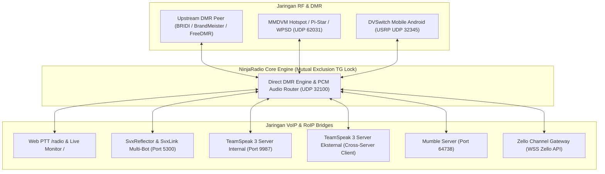

# Buku Manual Penggunaan & Administrasi Lengkap NinjaRadio (A to Z)

Dokumen ini adalah panduan operasional menyeluruh (*End-to-End Manual*) untuk pengguna maupun Administrator **NinjaRadio Multi-Mode RoIP & DMR Core System**. Panduan ini membahas seluruh halaman, fitur, alur *cross-link* antar jaringan, manajemen bot, aturan *firewall*, hingga mekanisme *hot-reload* (kapan perubahan langsung aktif otomatis dan kapan memerlukan *restart*).

---

## 1. Gambaran Umum & Arsitektur Sistem

**NinjaRadio** adalah pusat interkoneksi radio digital (*Universal Radio-over-IP Core*) yang menghubungkan berbagai protokol komunikasi suara secara *real-time* dan dua arah (*bi-directional*) berdasarkan **Talkgroup (TG)**:

### Prinsip Kerja Utama:
1. **Routing Berbasis Talkgroup (TG)**: Semua jembatan (*bridge*) yang disetel ke nomor **Talkgroup (TG)** yang sama akan saling mendengar dan berbicara satu sama lain secara otomatis.
2. **Mutual Exclusion TG Lock (Anti-Tabrakan)**: Jika ada satu stasiun sedang berbicara di sebuah TG (misal dari HT DMR), jalur lain pada TG tersebut dikunci sementara agar suara tidak bertumpuk (*double modulation*).
3. **Anti-Echo Loop**: Paket audio yang berasal dari suatu bot (misal Bot TS3 Luar di port `12355`) akan diteruskan ke seluruh jaringan pada TG tersebut (termasuk Bot TS3 Lokal di port `12356` dan Bot SvxLink), namun **tidak dipantulkan kembali** ke bot pengirimnya sendiri.
4. **Dynamic Callsign Carry-Over**: Nama pengirim asli dari DMR/SvxLink/TS3 akan diteruskan lintas protokol (misal: nama bot di TeamSpeak otomatis berubah menjadi `[DMR] CALLSIGN NAMA` saat ada stasiun berbicara, lalu kembali ke nama default saat selesai).

---

## 2. Tabel Referensi Cepat: Apakah Perlu Restart Saat Mengubah Setting?

Salah satu pertanyaan paling penting dalam operasional harian adalah: **"Kalau saya baru tambah/edit bot atau ubah konfigurasi, apakah harus restart container/server?"**

> [!IMPORTANT]
> **Aturan Emas NinjaRadio**: Hampir seluruh perubahan dari Web UI kini dilengkapi dengan **Auto-Reload Watcher** di background sehingga **TIDAK PERLU restart manual lewat SSH**. Selain itu, **DILARANG me-restart container `ninjaradio_ts3` (Server TeamSpeak Utama)** agar user yang sedang online tidak terputus.

| Tindakan / Perubahan di Web UI | Apakah Perlu Restart Manual? | Mekanisme yang Terjadi di Belakang Layar | Waktu Aktif |
| :--- | :--- | :--- | :--- |
| **Tambah / Edit / Hapus Bot TeamSpeak 3** (Internal maupun Eksternal) | **TIDAK PERLU** (Otomatis) | Watcher di `ninjaradio_ts3_bridge` mendeteksi perubahan `config.json` setiap 3 detik, menjalankan `sync_bots.py`, membersihkan bot lama, dan me-reload daemon bot secara otomatis. | **3 – 6 detik** |
| **Tambah / Edit / Hapus Bot SvxLink** | **TIDAK PERLU** (Otomatis) | Backend menulis penanda `.svxlink_reload`. Container `ninjaradio_svxreflector` dan `ninjaradio_svxlink_bridge` otomatis me-reload daftar auth & instance `svxlink` untuk bot baru tersebut. | **3 – 5 detik** |
| **Ganti Profil Operator / Pindah TG di Web PTT (`/radio`)** | **TIDAK PERLU** (Instan) | Mengirim paket biner `TLV SET_INFO` secara dinamis tanpa pernah me-restart daemon vocoder. | **Instan (0 detik)** |
| **Tambah / Edit / Hapus Data Callbook (`/callbook`)** | **TIDAK PERLU** (Instan) | Tersimpan langsung di database SQLite dan file `subscriber_ids.csv` disinkronkan ke Core secara langsung. | **Instan (0 detik)** |
| **Approve / Suspend Akun Operator (`/admin/registrations`)** | **TIDAK PERLU** (Instan) | TX-Firewall langsung membaca status terbaru dari database pada saat PTT ditekan. | **Instan (0 detik)** |
| **Tambah / Edit Upstream DMR Peer (misal BRIDI)** di `/settings` | **TIDAK PERLU** (Otomatis) | Core Engine otomatis menyinkronkan ulang koneksi `HomeBrewClient` peer di background. | **2 – 5 detik** |
| **Ubah Konfigurasi Zello / Upload Private Key** di `/settings` | **TIDAK PERLU** (Otomatis) | Watcher di `ninjaradio_zello_bridge` mendeteksi perubahan konfigurasi dan menyambung ulang ke channel Zello. | **3 – 5 detik** |
| **Update Kode Sumber (`git pull` di VPS)** | **YA (Build/Restart Container Terkait)** | Hanya diperlukan jika ada pembaruan kode program dari GitHub (`docker compose up -d --build <nama-service>`). | **10 – 45 detik** |

---

## 3. Panduan Lengkap Halaman demi Halaman (A to Z)

### 3.1. Membuka Kunci Mode Admin (Security PIN)
Secara default, pengunjung web berada dalam mode **Lihat Saja (*Read-Only*)**. Untuk mengedit bot, mengubah pengaturan, atau mengelola Callbook:
1. Klik ikon **Gembok (Admin Lock)** di pojok kanan atas navigasi.
2. Masukkan **PIN Admin** Anda.
3. Setelah terbuka, seluruh tombol **Tambah**, **Edit**, **Hapus**, dan menu **Settings** akan aktif.

---

### 3.2. Dashboard Utama (`/`) — Live Monitor & Telemetry
Halaman beranda menampilkan kondisi *real-time* seluruh jaringan:
- **Banner Transmisi Aktif**: Menampilkan siapa yang sedang berbicara (*Callsign*, *DMR ID*, *Nama*, *Talkgroup*, *TimeSlot*, dan asal jaringan seperti `RF DMR`, `SVX / SDR`, `TeamSpeak 3`, `Mumble`, atau `Zello`).
- **Tombol Live Audio Monitor (Speaker)**:
  - Klik tombol **Audio Monitor** sekali di browser Anda untuk membuka kunci *Web AudioContext* (aturan wajib browser modern).
  - Dilengkapi *jitter cushion* 150ms dan *cosine envelope* agar suara TDMA DMR terdengar halus tanpa suara "jedug" (*pop/click*).
- **Status Layanan Core**: Menampilkan indikator kesehatan *Analog_Bridge*, *MMDVM_Bridge*, *Direct DMR Vocoder*, dan *FreeDMR Master*.

---

### 3.3. Web PTT Radio Transceiver (`/radio`)
Antarmuka radio komunikasi dua arah langsung dari browser (PC maupun HP):
- **Pemilihan Talkgroup (TG) & Memory Channel**:
  - Pilih channel preset (seperti `TG 1025`, `TG 510`, `TG 510990`) atau ketik nomor TG secara manual di mode **VFO**.
  - **Aturan Prioritas TG**: TG yang Anda pilih di `/radio` selalu menjadi prioritas mutlak selama Anda menekan PTT.
- **Mode Transmisi**:
  - **Manual PTT**: Tekan dan tahan tombol besar **PTT** (atau tombol `Spasi` di keyboard) untuk berbicara, lepaskan untuk *unkey*.
  - **Mode VOX (Voice Operated Transmit)**: Aktifkan sakelar **VOX** jika ingin berbicara tanpa menekan tombol. Sistem dilengkapi:
    - *Dual-Threshold Hysteresis (Schmitt Trigger)*: Mencegah mikrofon berkedip-kedip karena suara latar belakang (*noise*).
    - *Hangover Timer (400–600ms)*: Menahan PTT tetap aktif sejenak saat Anda mengambil napas di tengah kalimat.
    - *Hard Time-Out Timer (TOT 180 detik)*: Memutus transmisi otomatis jika tidak sengaja terbuka terus-menerus.
- **DSP Audio Filter**: Pengaturan *Mic Gain*, *Noise Gate*, dan *Compressor* tersedia langsung di panel audio.

---

### 3.4. SvxReflector & Cross-Link Hub (`/svxlink`)
Pusat kendali interkoneksi **SvxReflector (Port 5300)** dan jembatan lintas protokol (**SvxLink $\leftrightarrow$ DMR $\leftrightarrow$ TeamSpeak $\leftrightarrow$ Zello $\leftrightarrow$ Mumble**).

#### A. Membaca Kartu Node (Unified Node Matrix)
Setiap kartu menampilkan:
- **Header**: Callsign Node/Bot dan badge `TG <nomor>` (berubah menjadi hijau berkedip `TALKING · TG <nomor>` saat ada suara).
- **Rute Interkoneksi**: Menampilkan alamat host dan arah jembatan, contoh:
  - `Ext TS3 (SETTING PERANGKAT) ⇆ SVX:SVXLINKCROSS510 + TS3:TS3-LOKAL-51024 + TG 51024`
- **Pills `TGs:`**: Daftar seluruh Talkgroup yang dimonitor oleh node/server tersebut secara dinamis.
- **Filter Bar (`SOURCE` & `TYPE`)**: Anda dapat menyaring tampilan berdasarkan `All`, `SvxLink`, `TeamSpeak`, `DMR`, `DVSwitch`, `Mumble`, `Zello`, atau `Hotspot`.

#### B. Menambah / Mengedit Node Bot SvxLink
1. Klik tombol **`+ Tambah Node Manual`** di bagian atas (atau klik ikon **Pensil (`Edit`)** di pojok kanan bawah kartu SvxLink yang sudah ada).
2. Isi kolom:
   - **Node Callsign / ID**: Nama bot di SvxReflector (contoh: `SVXLINKCROSS510`).
   - **Nama Room / Label**: Keterangan ruangan (contoh: `Crosslink 51024`).
   - **Target Talkgroup (TG)**: Nomor TG tujuan (contoh: `51024`).
   - **DMR TimeSlot**: Pilih `Slot 1` atau `Slot 2` (umumnya `Slot 2`).
   - **Modul EchoLink (Opsional)**: Centang jika bot ini juga ingin disambungkan ke jaringan EchoLink dunia.
3. Klik **Simpan**. Dalam **3–5 detik**, SvxReflector dan SvxLink Bridge otomatis menyalakan bot tersebut **tanpa perlu restart apa pun**.

#### C. Mengelola Bot TeamSpeak 3 (Internal & Cross-Server Eksternal) dari `/svxlink`
Kini Anda dapat mengedit TG manual maupun mengatur *cross-link* TeamSpeak langsung dari halaman `/svxlink`:
1. Pada kartu **`NINJA-TS3`** (server internal) atau kartu bot eksternal (misal **`TS32TS3`**), klik tombol **`Edit`** di pojok kanan bawah kartu.
2. Panel **Kelola Bot TeamSpeak 3 (Internal & Cross-Server Eksternal)** akan terbuka:
   - **Daftar Bot TeamSpeak Aktif**: Menampilkan seluruh bot berlabel **`INT`** (Internal `127.0.0.1:9987`) dan **`EXT`** (Server Luar). Klik salah satu untuk mengeditnya, atau klik **`+ Bot TS3 Baru`**.
   - **Nama Bot TS3**: Nama tampilan bot di room TeamSpeak (contoh: `TS32TS3` atau `TS3-LOKAL-51024`).
   - **Alamat Server TS3**:
     - Klik tombol **`Lokal`** untuk mengisi `127.0.0.1:9987` (server TS3 milik Anda sendiri).
     - Atau ketik `IP:Port` server TeamSpeak luar (contoh: `38.47.176.16:9191`).
   - **Nama Room / Channel TS3**: Ketik nama room persis sesuai huruf besar/kecilnya di server tujuan (contoh: `SETTING PERANGKAT` atau `Crosslink ROIP`).
   - **Pilih Bot Tujuan Cross-Link (Dropdown Otomatis)**:
     - Pilih dari daftar **Bot SvxLink** atau **Bot TS3 Internal** yang tersedia. Saat dipilih, kolom **Talkgroup (TG)** dan **Linked SvxLink Bot** akan terisi otomatis!
   - **Target Talkgroup (Edit Manual TG)**: Anda juga bebas mengetik angka TG secara manual (misal `51024`).
3. Klik **`💾 SIMPAN & SINKRONKAN BOT TS3`**. Daemon `teamspeak-bridge` akan otomatis menyinkronkan ulang bot dalam **3–6 detik** tanpa mengganggu server TS3 utama.

#### D. Generator Konfigurasi `svxlink.conf` (Untuk Node Radio Fisik / Repeater Luar)
Di bagian bawah halaman `/svxlink`, terdapat generator otomatis bagi rekan-rekan yang ingin menyambungkan Raspberry Pi / Mini PC (Repeater/Simplex) mereka ke SvxReflector NinjaRadio:
1. Isi Callsign, TG Default, Monitored TGs, lalu salin skrip *One-Line Deploy*.
2. Tempelkan di terminal Raspberry Pi, maka node fisik mereka langsung terhubung ke server Anda.

---

### 3.5. Panduan Skenario: Membuat Cross-Link Dua Server TeamSpeak Berbeda (Bi-Directional)

Jika Anda ingin menghubungkan sebuah ruangan di **Server TeamSpeak Luar** (milik komunitas lain) dengan ruangan di **Server TeamSpeak Internal Anda** sekaligus **SvxLink & DMR**:

> [!TIP]
> **Konsep Kunci**: Karena ada 2 server TeamSpeak yang berbeda, kita menugaskan **2 Klien Bot HoneyBBQ** (1 bot masuk ke server luar, 1 bot masuk ke server lokal Anda) dan mengikat keduanya pada **nomor Talkgroup (TG) yang sama** (contoh: `TG 51024`).

**Langkah-langkah (Cukup dari Web UI):**
1. **Pastikan Room di Server Lokal Sudah Ada**:
   - Buat channel di TeamSpeak lokal Anda (misal: `Crosslink ROIP`) dan daftarkan di daftar Room TS3 dengan `TG 51024`.
2. **Buat Bot ke-1 (Klien Server Lokal)**:
   - Nama Bot: `TS3-LOKAL-51024`
   - Server: `127.0.0.1:9987`
   - Channel: `Crosslink ROIP`
   - Talkgroup: `51024` (Slot 2)
3. **Buat Bot ke-2 (Klien Server Luar)**:
   - Nama Bot: `TS32TS3`
   - Server: `38.47.176.16:9191` (alamat server luar)
   - Channel: `SETTING PERANGKAT` (nama room di server luar)
   - Pilih Cross-Link ke: `TS3-LOKAL-51024` / `SVXLINKCROSS510` (**TG `51024`**, Slot 2)
4. **Buat Bot SvxLink (Opsional jika ingin tembus ke SvxReflector juga)**:
   - Buat bot SvxLink `SVXLINKCROSS510` pada **TG `51024`**.
5. **Selesai!**
   - Ketika orang di server luar berbicara di room `SETTING PERANGKAT` $\rightarrow$ Bot `TS32TS3` menangkap suaranya $\rightarrow$ dikirim ke Core TG 51024 $\rightarrow$ dipancarkan keluar oleh `TS3-LOKAL-51024` di room `Crosslink ROIP` Anda DAN dipancarkan ke SvxReflector `SVXLINKCROSS510`.
   - Ketika Anda berbicara di room `Crosslink ROIP` server lokal (atau dari SvxLink / HT DMR di TG 51024) $\rightarrow$ suara langsung dipancarkan keluar oleh bot `TS32TS3` di room `SETTING PERANGKAT` server luar!

---

### 3.6. Halaman TeamSpeak 3 Hub (`/teamspeak`)
Menampilkan status *live* dari server TeamSpeak 3 internal Anda (`43.173.13.117:9987`):
- Daftar seluruh *Voice Channel* beserta jumlah user yang berada di tiap room.
- Daftar user yang sedang online dan indikator siapa yang sedang berbicara.
- Tombol pintas untuk langsung membuka aplikasi **TeamSpeak 3 Client** di PC/HP (`ts3server://...`).

---

### 3.7. Halaman Mumble / Mumla (`/mumla`)
Panduan dan pantauan untuk jembatan **Mumble VoIP Server (Port 64738)**:
- Pengguna Android dapat mengunduh aplikasi **Mumla**, sedangkan pengguna PC menggunakan **Mumble Client**.
- Cukup hubungkan ke alamat IP VPS Anda, port `64738`, tanpa password. Bot `NINJA-MUMBLE` di dalam room akan otomatis menjembatani suara Mumble dua arah dengan Talkgroup utama.

---

### 3.8. Halaman DVSwitch Mobile (`/dvswitch`)
Panduan koneksi untuk pengguna aplikasi **DVSwitch Mobile** di Android (Protokol **USRP UDP Port 32345**):
- **Keunggulan Multi-Client**: Banyak pengguna DVSwitch Mobile dapat terhubung ke port `32345` secara bersamaan.
- **Isolasi Identitas**: Setiap pengguna yang mengirim perintah registrasi atau *Dial String* (`*1025`, `*510`, dll.) akan dicatat identitas Callsign, DMR ID, dan Talkgroup pilihannya masing-masing tanpa saling menimpa dengan pengguna Web PTT.

---

### 3.9. Halaman Internal DMR Master Server (`/serverdmr`)
Pusat informasi untuk menghubungkan **MMDVM Hotspot (Pi-Star / WPSD)** atau Repeater DMR langsung ke server NinjaRadio:
- **Port Master**: UDP `62031`
- **Password Master**: `passw0rd` (atau sesuai konfigurasi `config.json`)
- Menyediakan generator blok konfigurasi `[DMR Network]` siap salin untuk ditempelkan ke menu *Expert -> MMDVMHost* di Pi-Star/WPSD.
- Mendukung penuh opsi `Options=TS1=...;TS2=...` (*RPTO dynamic static talkgroup linking*).

---

### 3.10. Halaman Audio Matrix (`/matrix`)
Visualisasi topologi rute silang (*Cross-Point Matrix*) antar semua jaringan yang aktif:
- Memudahkan Anda memeriksa sekilas jaringan mana saja yang terhubung ke `TG 1025`, `TG 510`, `TG 510990`, `TG 51024`, dsb.

---

### 3.11. Halaman Callbook & TX-Firewall (`/callbook`)
Sistem keamanan dan buku panggil (*Callsign Database*) terpusat:
1. **Cara Kerja TX-Firewall**:
   - Setiap transmisi dari RF DMR / DVSwitch Mobile / Web PTT diperiksa terhadap database Callbook.
   - **Pengecualian Gateway**: Transmisi yang masuk dari jembatan resmi (**TeamSpeak Bridge**, **SvxLink Bridge**, **Mumble Bridge**, **Zello Bridge**) telah di-*whitelist* sebagai `Gateway Authenticated` sehingga selalu diizinkan meneruskan suara lintas Talkgroup (termasuk TG khusus seperti `51024`).
2. **Fitur `Allowed TGs Override` (Pembatasan TG per Operator)**:
   - Jika kolom *Allowed TGs* pada suatu Callsign dikosongkan (`*`), operator tersebut bebas berbicara di semua TG.
   - Jika diisi (misal `1025, 510990`), maka operator tersebut hanya diizinkan PTT di TG tersebut saat menggunakan HT/DVSwitch.
3. **Sinkronisasi Otomatis URL CSV (Auto-Sync)**:
   - Anda dapat menambahkan URL sumber Callbook eksternal (format CSV RadioID/Komunitas). Sistem akan menyinkronkan database secara berkala setiap 15 menit.

---

### 3.12. Halaman Logbook & Rekaman (`/logbook`)
- Menampilkan riwayat lengkap percakapan (*QSO Log*) beserta waktu mulai, durasi, Callsign, DMR ID, jaringan asal, dan Talkgroup tujuan.
- Anda dapat memutar ulang (*playback*) rekaman audio dari transmisi yang telah berlalu atau mengekspor data logbook.

---

### 3.13. Portal Registrasi Mandiri (`/register`, `/account`, `/admin/registrations`)
- **`/register`**: Halaman bagi anggota baru untuk mendaftarkan Callsign dan DMR ID mereka secara mandiri.
- **`/account`**: Halaman bagi anggota untuk mengecek status persetujuan akun mereka.
- **`/admin/registrations`**: Halaman khusus Admin untuk menyetujui (**Approve**), menolak (**Reject**), atau membekukan (**Suspend**) akun pendaftar. Akun yang belum *Approved* hanya bisa mendengarkan (*RX Only*).

---

### 3.14. Halaman Pengaturan Master (`/settings`)
Pusat kendali seluruh parameter sistem:
1. **Profil Operator Utama Server**: Mengatur Callsign dan DMR ID default server (`BD62BOT` / `1022057`) serta TG utama.
2. **Upstream DMR Peers**: Menambahkan koneksi ke server DMR luar (seperti `BRIDI`, `FreeDMR`, `BM`) beserta aturan pemetaan TG.
3. **Zello Channel Gateway**:
   - Mengatur Username, Password, Nama Channel Zello, dan Target TG.
   - Dilengkapi fitur **Upload Private Key (`.pem` / `.key`)** langsung dari browser agar bot Zello dapat melakukan autentikasi kriptografi ke server Zello.
4. **Manajemen Room & Bot TeamSpeak 3**:
   - Mengatur daftar *Room Mapping* (`CID` $\leftrightarrow$ `TG`) dan daftar *Bot Stationed* (baik internal maupun eksternal).

---

## 4. Panduan Troubleshooting Cepat (FAQ Operasional)

| Gejala / Masalah | Penyebab Umum | Solusi Cepat |
| :--- | :--- | :--- |
| **Bot TS3 baru dibuat tapi tidak masuk ke room yang diinginkan di server luar** | Nama room di kolom *Channel* tidak sama persis (huruf besar/kecil atau spasi) dengan nama room di server TS3 tujuan. | Klik **Edit** pada bot TS3 tersebut di `/svxlink` atau `/settings`, samakan persis penulisan nama room-nya (contoh: `SETTING PERANGKAT`), lalu klik **Simpan**. Tunggu 5 detik, bot akan pindah otomatis. |
| **Suara dari bot TS3 sudah bergerak (lampu biru menyala di TS3), tapi tidak terdengar di client Anda** | Akun TeamSpeak Anda belum masuk ke room yang sama dengan bot tersebut, atau speaker TS3 Anda ter-*mute*. | Pastikan akun Anda berada di dalam room yang sama dengan bot (`Crosslink ROIP` di server lokal, atau `SETTING PERANGKAT` di server luar). |
| **Tidak ada suara keluar di browser saat membuka Dashboard (`/`)** | Browser memblokir *autoplay* audio sebelum ada klik dari pengguna. | Klik satu kali pada tombol **Live Audio Monitor (Speaker)** di halaman Dashboard. |
| **Muncul pesan `Server error: Access denied` di log SvxLink** | Callsign node belum terdaftar di daftar otorisasi SvxReflector. | Tambahkan Callsign tersebut melalui tombol **Tambah Node Manual** di halaman `/svxlink` — sistem otomatis mendaftarkannya dan me-reload SvxReflector dalam 3 detik. |
| **Ingin mengecek log *real-time* di VPS (Opsional bagi Admin Teknis)** | Memantau paket secara mendalam via SSH. | Gunakan perintah: • `docker logs -f ninjaradio_ts3_bridge` • `docker logs -f ninjaradio_core` • `docker logs -f ninjaradio_svxlink_bridge` |
